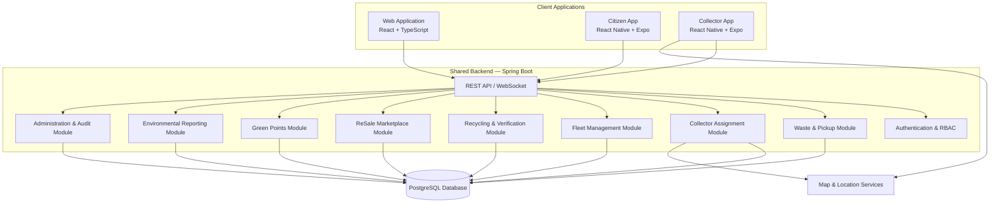

<div align="center">

# ♻️ WasteLoopBD

### Towards a Cleaner, Smarter and Greener Dhaka.

**A digital waste management and circular economy platform connecting citizens, collectors, recycling centers and green businesses.**

[](#-project-status)
[](#-technology-stack)
[](LICENSE)
[](#-project-status)

**Team Dark Coders · United International University · Dhaka, Bangladesh**

</div>

---

## 📖 Overview

**WasteLoopBD** is an academic software engineering project that proposes an integrated digital platform for improving waste collection, material recovery, reuse and recycling in **Dhaka City, Bangladesh**.

The platform connects citizens with waste collectors, recycling centers, buyers, eco-friendly shops and city-level operations through coordinated digital workflows. Citizens can record household waste, request pickups and follow collection progress. Collectors can manage assigned tasks and submit collection records. Recycling centers can verify delivered materials, while eligible recovery activities can contribute to Green Points and environmental reporting.

WasteLoopBD is designed around a circular-economy principle: **recover useful materials, keep them in circulation and reduce avoidable waste.**

> **Important:** WasteLoopBD is currently an academic project under development. The features and workflows in this README describe the intended system scope; they should not be interpreted as proof of completed implementation or city-wide deployment.

---

## 🎯 Objectives

- Digitize household waste recording and collection requests.
- Improve coordination between citizens and waste collectors.
- Support transparent pickup, delivery and material-verification workflows.
- Encourage responsible waste segregation, reuse and recycling.
- Provide incentives for verified material recovery through Green Points.
- Connect users with resale opportunities and eco-friendly businesses.
- Maintain traceable records for waste batches and recovery activities.
- Present environmental impact estimates using documented calculation factors.
- Support better operational visibility for authorized city and platform administrators.

---

## ❗ Problem Statement

Urban waste management involves multiple participants and operational stages. When these activities are handled through disconnected communication channels or manual records, it can become difficult to coordinate pickups, verify collected quantities, track recovered materials and understand the final outcome of waste.

WasteLoopBD addresses several related challenges:

| Challenge | Intended platform response |
|---|---|
| Unstructured household waste records | Category-wise waste logging |
| Unclear pickup coordination | On-demand and scheduled pickup requests |
| Collector workload and capacity constraints | Rule-based assignment and capacity checks |
| Limited visibility after collection | Pickup status and delivery tracking |
| Unverified recovery quantities | Recycling-center weight and quality verification |
| Reusable materials treated as waste | ReSale and reuse marketplace |
| Limited incentives for responsible recovery | Green Points for eligible verified activities |
| Fragmented operational information | Role-based dashboards and reports |

---

## 💡 Proposed Solution

WasteLoopBD brings the major stages of waste handling into one connected platform.

### The core lifecycle

```text
Citizen Records Waste
        │
        ▼
Pickup Request Created
        │
        ▼
Eligible Collector Assigned
        │
        ▼
Waste Collected and Weighed
        │
        ▼
Material Delivered to Recycling Center
        │
        ▼
Weight and Quality Verified
        │
        ▼
Recovery Record Updated
        │
        ├──────────────► Green Points Credited
        │
        ├──────────────► Environmental Estimate Updated
        │
        └──────────────► Reuse / Recycling / Marketplace
```

### Platform model

| Component | Primary users | Main responsibility |
|---|---|---|
| **Web Application** | Super Admin, City Authority, Operations, Fleet Manager, Recycling Center Manager, Green Business Owner | Administration, operations, verification, marketplace and reporting |
| **Citizen Mobile App** | Citizens | Waste logging, pickup requests, tracking, marketplace and rewards |
| **Collector Mobile App** | Waste Collectors / Riders | Assigned pickups, collection records, navigation and delivery confirmation |
| **Shared Backend** | All applications | Authentication, business rules, APIs, notifications and data processing |
| **Central Database** | Shared platform | Persistent and consistent application records |

One shared backend and database are intended to keep the web and mobile applications synchronized.

---

## ✨ Major Features

### 👤 1. Citizen Services

- Account registration, login and profile management.
- Daily household waste recording.
- Waste categorization and estimated weight entry.
- On-demand pickup requests.
- Scheduled pickup requests.
- Pickup location selection and GPS coordinates.
- Pickup status timeline.
- Collection history and verified recovery records.
- Green Points wallet and reward redemption.
- ReSale marketplace access.
- Eco-friendly shop and green business discovery.
- Community challenges and ward-level participation.

### 🚛 2. Waste Collection Operations

- Collector and rider profiles.
- Availability and workload tracking.
- Vehicle type and maximum-capacity records.
- Rule-based collector assignment.
- Pickup task acceptance or rejection.
- Task reassignment when a collector is unavailable.
- Pickup location and navigation support.
- Actual collected-weight submission.
- Collection proof and delivery confirmation.
- Multi-pickup grouping where operationally appropriate.

### 🏭 3. Recycling Center Management

- Recycling center registration and approval workflow.
- Center profile and accepted-material categories.
- Incoming waste delivery records.
- Waste-batch creation and tracking.
- QR-based batch identification.
- Actual weight and material-quality verification.
- Processing and recovery records.
- Verified material-recovery history.

### 🛒 4. ReSale and Reuse Marketplace

- Listings for reusable household goods.
- Listings for recyclable raw materials.
- Buy, sell and donation-oriented listings.
- Repair and reuse service listings.
- Product availability and inventory management.
- Order and transaction status tracking.
- Buyer and seller interaction.
- Marketplace moderation by authorized administrators.

### 🌱 5. Green Points and Rewards

- Configurable point rates by eligible material category.
- Points based on verified recovery records.
- Citizen reward wallet and transaction history.
- Reward catalog and redemption workflow.
- Duplicate-credit prevention.
- Administrative point-rate configuration.

**Reward principle:** Points are intended to encourage responsible segregation and verified recovery—not the production of more waste.

### 🏪 6. Eco-Friendly Shops and Green Businesses

- Green business profiles.
- Eco-friendly product and service catalog.
- Business location and contact information.
- Offers and promotions.
- Eligible Green Points discounts.
- Customer ratings and feedback.
- Business listing moderation.

### 🌍 7. Environmental Impact and Traceability

- Basic estimated environmental impact reporting.
- Documented emission factors for supported material activities.
- Separation of collected weight and verified recovered weight.
- QR-based Digital Waste Passport for batch traceability.
- Recovery and processing history.
- Area-wise and category-wise reports.

Environmental figures must be labeled as **estimates** unless supported by verified measurement. A pickup alone does not prove that a material was recycled or that a specific amount of carbon emissions was avoided.

### 🏛️ 8. Administration and Monitoring

- Role-based dashboards.
- User and role management.
- Collector, vehicle and fleet management.
- Pickup and delivery monitoring.
- Recycling center approval and oversight.
- Marketplace moderation.
- Reward configuration.
- Complaints and dispute handling.
- Notifications and activity logs.
- Operational and environmental reports.

---

## 🔄 How the System Works

### Workflow A — Household Pickup

1. A citizen records the waste category and estimated quantity.
2. The citizen selects an available pickup slot and location.
3. The backend validates the request and creates a tracking record.
4. The assignment service identifies eligible collectors.
5. The selected collector receives the task.
6. The collector accepts the task and proceeds to the pickup location.
7. The collector records the actual collected weight and submits collection proof.
8. The waste is delivered to an appropriate recycling center.
9. The center verifies the received quantity and quality.
10. The platform updates the recovery record and applicable citizen rewards.

### Workflow B — Collector Assignment

The assignment process uses defined operational rules rather than AI.

A collector may be considered eligible based on:

- Availability and active status.
- Distance from the pickup location.
- Remaining vehicle capacity.
- Vehicle and waste-category compatibility.
- Current workload.
- Operational route efficiency.

**Illustrative capacity example**

| Collector | Distance | Current load | Max capacity | Remaining capacity | Result |
|---|---:|---:|---:|---:|---|
| Rider A | 0.5 km | 10 kg | 20 kg | 10 kg | Eligible |
| Rider B | 0.8 km | 8 kg | 20 kg | 12 kg | Eligible |
| Rider C | 0.3 km | 12 kg | 20 kg | 8 kg | Not eligible for a 10 kg request |

If all other conditions are equal, Rider A may be preferred because the pickup is closer. The final assignment must still validate availability, compatibility and capacity.

### Workflow C — Verified Green Points

1. A pickup is completed and its actual weight is recorded.
2. The recycling center confirms the received material.
3. The platform checks the recovery record and point eligibility.
4. The configured category rate is applied.
5. The transaction is recorded in the citizen's Green Points wallet.
6. The same verified batch cannot be credited more than once.

**Illustrative calculation**

```text
Verified plastic recovery = 10 kg
Configured rate           = 10 points / kg

Green Points = 10 × 10
             = 100 points
```

The rate is an example and should be configurable by authorized administrators.

### Workflow D — ReSale and Reuse

1. A citizen or approved business creates a listing.
2. The listing is reviewed according to platform rules.
3. A buyer discovers the item or material.
4. The buyer places an order or contacts the seller.
5. The seller updates fulfillment status.
6. The platform records the transaction.

---

## 📏 Key Business Rules

| Rule | Expected behavior |
|---|---|
| Waste generation vs. recovery | Generated, collected, delivered and recovered quantities must remain distinct |
| Reward eligibility | Only eligible, verified recovery activities can earn recovery-based points |
| No duplicate rewards | A verified batch or recovery event cannot receive duplicate credits |
| Capacity validation | Assignment must not exceed the collector's remaining vehicle capacity |
| Atomic reservation | Capacity should be reserved safely during assignment to prevent concurrent overbooking |
| Collector availability | Inactive, unavailable or incompatible collectors must not receive tasks |
| Split pickup | Split assignment should be considered only when no single eligible collector can handle the request and the citizen agrees |
| Material verification | Recycling-center records determine verified received weight and quality |
| Environmental reporting | Estimates must use documented factors and clearly state their assumptions |
| QR privacy | Public QR pages must not expose private citizen information |
| Auditability | Important administrative and verification actions should retain actor, time and outcome |

---

## 👥 User Roles

| Role | Main responsibilities |
|---|---|
| **Super Admin** | Platform configuration, role management, oversight and audit |
| **City Authority** | Area-level monitoring, operational reports and authorized oversight |
| **Citizen** | Waste logging, pickup requests, tracking, marketplace and rewards |
| **Waste Collector / Rider** | Pickup tasks, collection records, proof and delivery |
| **Fleet Manager** | Collector availability, vehicles, capacity and fleet operations |
| **Recycling Center Manager** | Incoming batches, weight verification and recovery records |
| **Buyer** | Browse listings and manage purchases |
| **Green Business Owner** | Manage business profile, products, offers and eligible promotions |

Access to each feature must be controlled through role-based authorization.

---

## 🛠️ Technology Stack

The following is the intended technology stack for the project. Individual tools may be finalized or adjusted during implementation.

| Layer | Technologies |
|---|---|
| Web frontend | React.js, TypeScript, Tailwind CSS, React Router |
| Mobile applications | React Native, Expo, TypeScript |
| Backend | Java, Spring Boot |
| API communication | REST API |
| Real-time communication | Spring WebSocket, STOMP |
| Database | PostgreSQL |
| ORM / persistence | Spring Data JPA, Hibernate |
| Authentication and security | Spring Security, JWT, BCrypt, RBAC |
| Database migration | Flyway |
| Maps | Leaflet, OpenStreetMap |
| Data visualization | Recharts |
| Form handling | React Hook Form, Zod |
| Backend testing | JUnit, Mockito |
| API testing | Postman |

### Why this stack?

- **React and TypeScript** support reusable, maintainable web interfaces.
- **React Native and Expo** provide a shared mobile development approach for citizen and collector applications.
- **Spring Boot** supports structured backend services and enterprise application patterns.
- **PostgreSQL** provides relational consistency for users, requests, assignments, batches, transactions and rewards.
- **Spring Security and JWT** support authenticated access and role-based authorization.
- **Flyway** helps version and manage database schema changes.

---

## 🏗️ System Architecture

The academic implementation is planned around a **modular monolith**: one Spring Boot backend organized into clear domain modules. This keeps the system easier to develop, test and deploy than introducing microservices prematurely.



### Architecture principles

- Keep business logic out of controllers.
- Separate API, service and persistence responsibilities.
- Use DTOs for request and response payloads.
- Validate inputs at API boundaries.
- Enforce authorization in backend services and security configuration.
- Use database transactions for sensitive multi-step operations.
- Keep modules cohesive and define clear service interfaces.
- Avoid introducing distributed infrastructure without a demonstrated need.

---

## 🧩 Core Domain Modules

| Module | Example responsibilities |
|---|---|
| Identity | Users, profiles, authentication and roles |
| Waste Management | Waste entries, categories and pickup requests |
| Collection | Assignments, task status and collection proof |
| Fleet | Collectors, vehicles, capacity and availability |
| Recycling | Centers, batches, verification and processing |
| Marketplace | Listings, orders, inventory and transactions |
| Rewards | Point rules, wallet entries and redemption |
| Green Business | Business profiles, catalogs and offers |
| Traceability | QR identifiers and batch history |
| Environmental Reporting | Verified activity and estimated impact |
| Administration | Approvals, complaints, reports and audit logs |

### Suggested domain entities

`User` · `Role` · `WasteCategory` · `WasteEntry` · `PickupRequest` · `PickupAssignment` · `Collector` · `Vehicle` · `CollectionRecord` · `RecyclingCenter` · `WasteBatch` · `VerificationRecord` · `MarketplaceListing` · `Order` · `GreenWallet` · `PointTransaction` · `Reward` · `GreenBusiness` · `AuditLog`

These are conceptual domain entities. Final names and relationships should follow the implemented database model.

---

## ☕ Object-Oriented Programming Concepts

WasteLoopBD is designed to demonstrate practical object-oriented programming principles through its backend domain and service architecture.

| OOP concept | Example application |
|---|---|
| Encapsulation | Keep entity state controlled through methods and validation |
| Abstraction | Define service contracts through interfaces |
| Inheritance | Share common properties among suitable user or domain types |
| Polymorphism | Support interchangeable assignment and reward strategies |
| Method overloading | Provide methods with different valid parameter sets where useful |
| Method overriding | Implement specialized behavior in concrete service classes |
| Exception handling | Handle invalid requests, unavailable capacity and failed transactions |
| Collections and Generics | Process lists of pickup tasks, batches and typed results |
| Streams and Lambdas | Filter and summarize eligible collectors or recovery records |
| SOLID principles | Keep classes focused and depend on abstractions |

### Example service abstractions

```java
public interface AssignmentStrategy {
    Collector assign(PickupRequest request, List<Collector> candidates);
}
```

```java
public interface RewardCalculationStrategy {
    int calculatePoints(WasteCategory category, double verifiedWeight);
}
```

```java
public interface WasteProcessing {
    void process(WasteBatch batch);
}
```

Possible custom exceptions include:

- `WasteRequestNotFoundException`
- `UnauthorizedAccessException`
- `InsufficientPointsException`
- `CollectorCapacityExceededException`
- `DuplicateRewardTransactionException`

These examples describe intended design patterns; they are not claims that these classes are already implemented.

---

## 🔐 Security and Data Integrity

Security and reliable records are essential because the platform handles user accounts, locations, collection tasks and reward transactions.

Planned controls include:

- JWT-based authentication.
- BCrypt password hashing.
- Role-Based Access Control (RBAC).
- Protected API endpoints.
- Server-side validation and authorization.
- DTO-based request handling.
- Environment-based secret configuration.
- Transactional updates for assignment and reward operations.
- Duplicate transaction prevention.
- Audit records for sensitive administrative actions.
- Restricted access to personal and location data.
- Public QR views that reveal batch information only, not private citizen details.

**Security principle:** Hiding a button in the frontend is not authorization. Every protected operation must be validated by the backend.

---

## 🗂️ Suggested Repository Structure

The final folder structure should reflect the actual repository. The following is a suggested organization for a multi-application project:

```text
WasteLoopBD/
│
├── apps/
│   ├── web/                    # React web application
│   ├── citizen-mobile/         # Citizen mobile application
│   └── collector-mobile/       # Collector mobile application
│
├── backend/
│   └── src/
│       ├── main/
│       │   ├── java/
│       │   │   └── com/wasteloopbd/
│       │   │       ├── config/
│       │   │       ├── controller/
│       │   │       ├── dto/
│       │   │       ├── entity/
│       │   │       ├── enums/
│       │   │       ├── exception/
│       │   │       ├── mapper/
│       │   │       ├── repository/
│       │   │       ├── security/
│       │   │       ├── service/
│       │   │       │   ├── interfaces/
│       │   │       │   └── implementations/
│       │   │       ├── strategy/
│       │   │       │   ├── assignment/
│       │   │       │   ├── reward/
│       │   │       │   └── processing/
│       │   │       └── util/
│       │   └── resources/
│       │       ├── db/migration/
│       │       └── application.yml
│       └── test/
│
├── docs/                       # Technical and academic documentation
├── .gitignore
├── LICENSE
└── README.md
```

---

## 🚀 Getting Started

WasteLoopBD is under development. Exact installation commands depend on the repository's current application structure and configuration. The following checklist describes the expected local setup.

### Prerequisites

Install the tools required by the applications you intend to run:

- Git
- Node.js and npm
- Java JDK (compatible with the selected Spring Boot version)
- PostgreSQL
- Android Studio or an Expo-compatible mobile development environment (for mobile work)

### 1. Clone the repository

```bash
git clone <repository-url>
cd WasteLoopBD
```

### 2. Configure the database

1. Create a PostgreSQL database for local development.
2. Configure the database connection in the backend environment or application configuration.
3. Set up the required database credentials.
4. Run the project's Flyway migrations when they are available.

### 3. Configure environment variables

Use the environment-variable template supplied by the project. Do not commit real credentials or secret keys.

### 4. Install application dependencies

Install dependencies from the relevant application directory using the package manager and scripts defined in that application's `package.json`.

### 5. Start the backend and applications

Start the Spring Boot backend, then run the web or mobile application using the scripts documented in their respective project directories.

> **Setup note:** This README intentionally does not invent npm scripts, module paths, database names or environment variable names. Add exact commands here after confirming the actual repository structure.

---

## ⚙️ Environment Configuration

Configuration values should be provided through environment variables or local, untracked configuration files.

Typical configuration categories include:

| Category | Purpose |
|---|---|
| Database URL | PostgreSQL connection |
| Database username and password | Database authentication |
| JWT secret | Token signing |
| Token expiration | Authentication lifetime |
| Web application origin | CORS configuration |
| Map configuration | Map tile or location-service settings |
| File storage | Collection proof and listing media, if enabled |
| Notification configuration | Email or push notification provider, if enabled |

Create a local environment file from the project's example template when one is provided.

**Never publish:** database passwords, JWT secrets, private API keys, service-account files or real user data.

---

## 🧪 Testing Strategy

Testing should cover business rules and important workflows, not only whether individual pages render.

| Test level | What to verify |
|---|---|
| Unit tests | Assignment rules, reward calculations and validation |
| Service tests | Pickup lifecycle, batch verification and marketplace operations |
| Repository tests | Persistence, constraints and query behavior |
| API tests | Authentication, authorization, validation and response handling |
| Integration tests | End-to-end backend workflows and database transactions |
| UI tests | Critical citizen, collector and administration journeys |

### High-priority test cases

- A collector with insufficient capacity cannot receive a pickup.
- Two concurrent requests cannot reserve more than the collector's available capacity.
- An unavailable collector cannot accept a new assignment.
- A reward cannot be credited twice for the same verified recovery event.
- Unverified collected weight cannot be treated as verified recovered weight.
- A user cannot access endpoints outside their assigned role.
- A public QR page does not expose private citizen information.

---

## 🗺️ Development Roadmap

The roadmap is divided into practical implementation phases. It does not imply that every listed feature is already complete.

### Phase 1 — Core Working System

- Authentication and role-based access.
- Citizen waste recording.
- On-demand and scheduled pickup requests.
- Rule-based collector assignment and capacity validation.
- Collector mobile workflows.
- Recycling center registration and verification.
- Waste-batch and QR traceability.
- Green Points calculation for verified recovery.
- Basic environmental estimates.
- Essential administration dashboard.

### Phase 2 — Circular Economy Features

- ReSale and reuse marketplace.
- Orders and inventory workflows.
- Eco-friendly shops and green business profiles.
- Offers and eligible points discounts.
- Community challenges and participation.
- Notifications, complaints and dispute handling.
- Expanded analytics and reports.

### Phase 3 — Quality and Pilot Readiness

- Unit, integration and UI testing.
- Security review and bug fixing.
- Performance and accessibility improvements.
- Web and mobile deployment preparation.
- Backend and database deployment.
- Monitoring, backup and operational documentation.
- Preparation for a limited pilot in selected Dhaka wards.

---

## 🚫 Project Scope and Exclusions

To keep the project focused, feasible and implementable within its academic scope, the following are **not included** in the current version:

- AI-based waste image recognition or categorization.
- AI-based waste prediction or demand forecasting.
- AI-based collector assignment or route optimization.
- IoT smart bins and sensor-based monitoring.
- Automated bin overflow detection.
- Solar-energy management.
- Biogas facility management.
- Advanced renewable-energy monitoring.
- Advanced EV, battery or charging infrastructure monitoring.

Collector assignment and route sequencing use defined operational rules and constraints. Environmental impact reporting uses documented calculation factors and is presented as an estimate.

---

## 📍 Geographic Scope

**Target area:** Dhaka City, Bangladesh.

The project is designed with Dhaka's urban waste-management context in mind. A practical academic demonstration or pilot should use selected wards or defined service areas rather than claiming full coverage of the city.

The system may store area, ward and pickup-location information to support localized operations and reporting.

---

## 📊 Project Status

| Area | Status |
|---|---|
| Project concept and scope | Defined |
| Core workflows | Designed |
| Intended architecture | Defined |
| Technology stack | Proposed |
| Web application | Under development |
| Mobile applications | Under development |
| Backend and database | Under development |
| Testing and deployment | Planned |

Status labels should be updated as implementation is completed and verified.

---

## 👨‍💻 Team

### Dark Coders

| No. | Team member | Student ID |
|---:|---|---|
| 1 | Sabbir Ahmed Shawon Akando | `0112330640` |
| 2 | Md. Rahatul Islam | `0112330958` |

---

## 🎓 Academic Information

| Item | Details |
|---|---|
| Project | WasteLoopBD |
| Course | Advanced Object Oriented Programming Laboratory |
| Department | Computer Science & Engineering (CSE) |
| University | United International University (UIU) |
| Team | Dark Coders |
| Geographic focus | Dhaka City, Bangladesh |
| Project status | Under Development |

---

## 🤝 Contributing

WasteLoopBD is an academic team project. Contributions and suggestions should follow the project's agreed development workflow.

1. Discuss significant changes with the team.
2. Create a separate branch for each feature or fix.
3. Follow the existing architecture and coding conventions.
4. Keep commits focused and descriptive.
5. Test affected workflows before submitting changes.
6. Update documentation when APIs, behavior or configuration change.
7. Never commit secrets, credentials or private user data.

Suggested branch naming:

```text
feature/<short-feature-name>
fix/<short-description>
docs/<documentation-change>
```

---

## 📄 License

This project is licensed under the **MIT License**. See the [`LICENSE`](LICENSE) file for the complete license text.

Copyright © 2026 Dark Coders.

---

<div align="center">

### ♻️ WasteLoopBD

**Turning Waste into Resources.**

*Towards a Cleaner, Smarter and Greener Dhaka.*

**Built with purpose by Dark Coders.**

</div>
